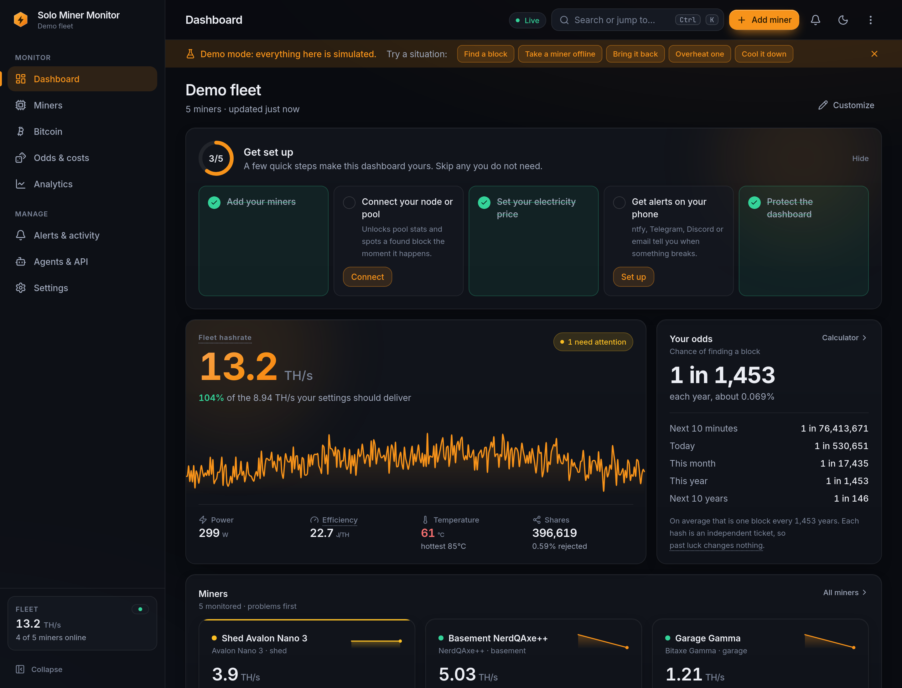
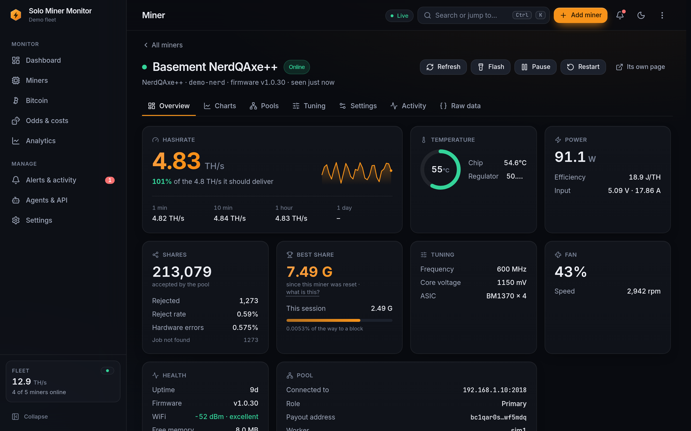
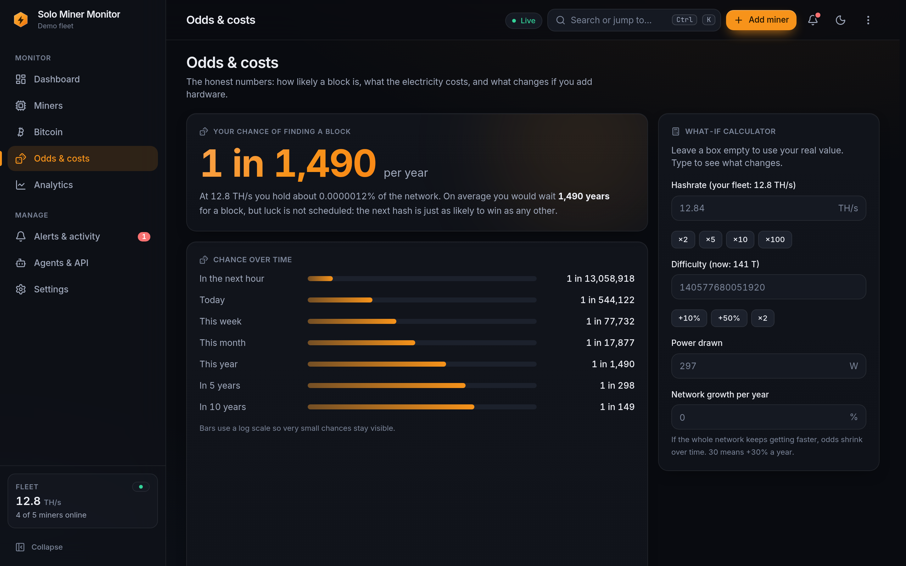
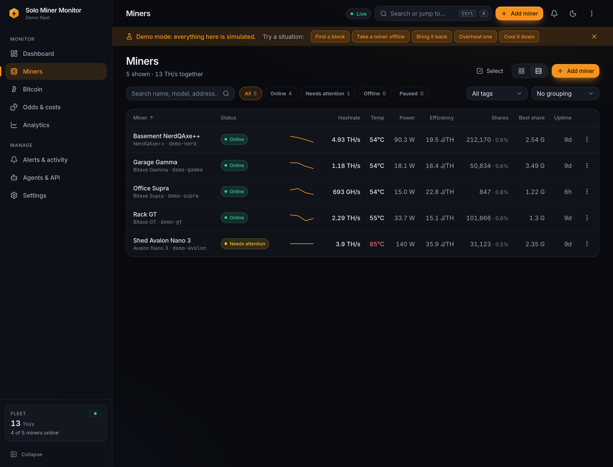
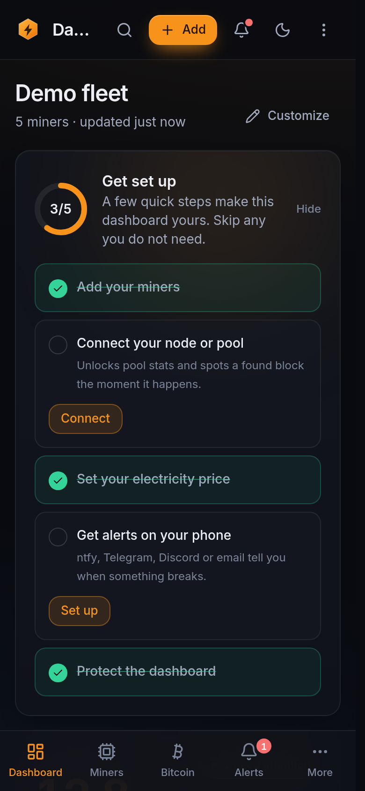

# Bitcoin Solo Miner Monitor

## A fleet dashboard for the solo-mining pleb

Bitaxe beside a NerdQAxe, Avalon beside an Antminer? Put compatible miners that speak AxeOS or cgminer APIs on one self-hosted dashboard. Check hashrate, heat, power, shares, pool state, node status, history and alerts without opening a tab for every box. Your browser can get back to doing browser things.

Keep an eye on the hash without babysitting twelve browser tabs. Spot miners that stop hashing, set alerts for heat or fan trouble, and see electricity estimates and solo-block odds from the same screen. Solo mining supplies enough uncertainty already; checking whether the fleet is running should be the easy part.

**Start here:** [Download the latest stable release](https://github.com/smokeysrh/bitcoin-solo-miner-monitor/releases/latest) · [Let your agent set it up](#let-your-agent-do-the-setup)

## Let your agent do the setup

Copy this into your agent chat. It uses the official project and release links, then follows the guide served by the app you actually install.

```text
Set up Bitcoin Solo Miner Monitor for monitoring my solo-mining fleet.

Start at https://github.com/smokeysrh/bitcoin-solo-miner-monitor and its latest stable release at https://github.com/smokeysrh/bitcoin-solo-miner-monitor/releases/latest. Read the repository's AGENTS.md, choose the official release artifact for my platform, and preserve my existing app data, settings and miner configuration. Back up the app data before an upgrade. After launch, read the running app's /llms.txt or current agent guide and follow it.

Set authentication for this network and use the least access scope needed. Keep passwords, tokens, RPC credentials and wallet addresses out of chat and logs; never guess them. Enter secrets through the app's secure fields. Scan only my private network, show me the miner and node/pool candidates, and wait for my confirmation before adopting miners. Ask only for information that is genuinely missing: Bitcoin Core RPC credentials, my electricity price, or which alert channel I want.

Start monitoring only. Verify the dashboard, health check and fleet overview. Ask before restarting a miner, changing a pool or payout address, tuning, changing firmware, deleting data or doing another destructive action.

Return the dashboard URL and a plain-English fleet report: health, hashrate, alerts and block odds. Include “Next 10 minutes” when the installed stable release exposes it. Explain that estimate as chance across a fixed window; it says nothing about when the next network block arrives.
```

## Install it

Choose the route that fits the machine that will watch the miners. The dashboard listens on port **8420** by default.

- **Windows desktop:** Download the Windows installer from the [latest stable release](https://github.com/smokeysrh/bitcoin-solo-miner-monitor/releases/latest), then follow its setup steps.
- **macOS or Linux desktop:** Your agent can install the official Python wheel from the [latest stable release](https://github.com/smokeysrh/bitcoin-solo-miner-monitor/releases/latest) and handle setup. Python 3.11 or newer is required. Prefer doing it yourself? The [installation guide](docs/PACKAGING.md) has the commands.
- **Linux home server, NAS or Raspberry Pi:** Use the [Docker Compose file](docker-compose.yml) and the official image `ghcr.io/smokeysrh/bitcoin-solo-miner-monitor`. The published image supports `linux/amd64` and `linux/arm64`. Open `http://<server>:8420`.
- **Windows or macOS with Docker Desktop:** Use the Compose file's port-mapping settings for a portable setup, then add miners by address or private network range.

For a first look without hardware, install the app and run `bsmm demo`; it opens a simulated fleet at `http://localhost:8420`.

### Upgrading without losing your setup

Keep the existing BSMM data directory, or the `bsmm-data` Docker volume, when replacing the app. Back it up from **Settings → Data & backup** before upgrading, and keep a protected copy of the encryption key as described in [SECURITY.md](SECURITY.md). Docker users should keep the volume mounted. Leave existing miner configuration in place while upgrading the dashboard.

Coming from v0.9.x? Preserve the old data directory first. `bsmm migrate-legacy` imports miner connection records from `config.db`; historical charts stay in the old installation. See the [legacy upgrade instructions](docs/PACKAGING.md#coming-from-v09x).

See [PACKAGING.md](docs/PACKAGING.md) for the longer install and upgrade guide.

## What it keeps an eye on

- **Your miners:** online state, hashrate, reported power, temperature, fans, accepted and rejected shares, pool, uptime and history. Fleet totals and per-miner pages update live.
- **Your node and pool:** Bitcoin Core, Public Pool, ckpool and mempool.space data sources can show chain height, sync state, fees and pool information.
- **Your costs and odds:** electricity estimates use the tariff you enter. The odds view describes modeled block probability across day, month and year windows, plus **Next 10 minutes**. That value is the modeled chance across the next ten minutes. The network can find a block at any time.
- **Useful alerts:** watch for offline or hot miners, fan trouble, hashrate drops, rejected shares, pool fallback, node trouble, new best shares, restarts, difficulty changes and blocks found. Send chosen alerts through ntfy, Telegram, Discord, Slack, Pushover, email, a webhook or Apprise.
- **Controls when you ask:** restart, identify, pause or resume, change a pool, set a fan, or enable supported tuning where the firmware allows it. Tuning starts off. Bulk controls offer a dry-run preview, and miner actions are audited.

## Miner compatibility

Support follows the miner's API and firmware response. BSMM has drivers for the AxeOS HTTP API and the cgminer API. A model that uses a different API, a restricted endpoint or an unsupported firmware fork may need a driver update.

| Miner or firmware family | Connection | What to expect |
|---|---|---|
| Bitaxe, NerdQAxe and related AxeOS devices, including supported Lucky and Magic Miner replies | AxeOS HTTP API | Live readings and identification from the firmware's model, board and chip fields. |
| Avalon, Antminer and Braiins OS devices exposing a compatible cgminer API | cgminer TCP API | Supported readings and model labels from the miner's own API responses. |

Available readings and controls vary by device and firmware. Identification includes confidence and supporting evidence, so an unfamiliar reply stays honestly labeled. Simulator and recorded-reply tests cover API behavior; physical compatibility still depends on the miner and its firmware.

See [miner identification](docs/miner-identification.md) for how the app names devices and handles uncertain replies.

## Odds, plainly

Solo mining is luck at scale. The app estimates your chance from your hashrate and network conditions, then puts the result into words and time windows. Most solo miners will never find a block. A probability for “Next 10 minutes” describes one fixed 600-second window. The actual block arrival time remains unknown. Treat odds as context for your setup; payouts remain luck.

## AI agents and other ways in

- **Agent guide:** after launch, read `http://<server>:8420/llms.txt` or `http://<server>:8420/api/v1/agent/guide`. The running app serves the current setup recipe and safety rules.
- **MCP:** connect to `http://<server>:8420/mcp`, or use `bsmm mcp` with the server URL and a scoped token.
- **REST:** `/api/v1` with an OpenAPI schema at `/openapi.json` and interactive docs at `/docs`.
- **CLI:** `bsmm setup`, `bsmm status`, `bsmm doctor`, and `bsmm odds`.

Give a monitoring agent a `read` token. Grant `control` only when you want it to operate miners; reserve `admin` for setup and settings. Agent instructions ask before a control action and never guess credentials or payout addresses.

## Security and network traffic

First start is open to the configured host until you set authentication. Set a dashboard password before sharing access beyond a trusted home network; use HTTPS in front of remote access. API tokens have `read`, `control` and `admin` scopes.

BSMM sends no telemetry. It connects to your miners and configured node or pool. Public network-data and GitHub release checks can be disabled with `BSMM_OFFLINE=1`; explicitly configured sources and alert destinations still make their intended requests. Dashboard passwords are hashed. Stored RPC and notification secrets are encrypted at rest and write-only through the API. Protect the data directory and its key like a password store.

Read [SECURITY.md](SECURITY.md) before exposing the dashboard beyond your LAN.

## Screenshots











## Links

- [Latest stable release](https://github.com/smokeysrh/bitcoin-solo-miner-monitor/releases/latest)
- [Source and issue tracker](https://github.com/smokeysrh/bitcoin-solo-miner-monitor)
- [Install and upgrade details](docs/PACKAGING.md)
- [Miner identification](docs/miner-identification.md)
- [Security notes](SECURITY.md)
- [Contributing](CONTRIBUTING.md)

MIT licensed. See [LICENSE](LICENSE).
